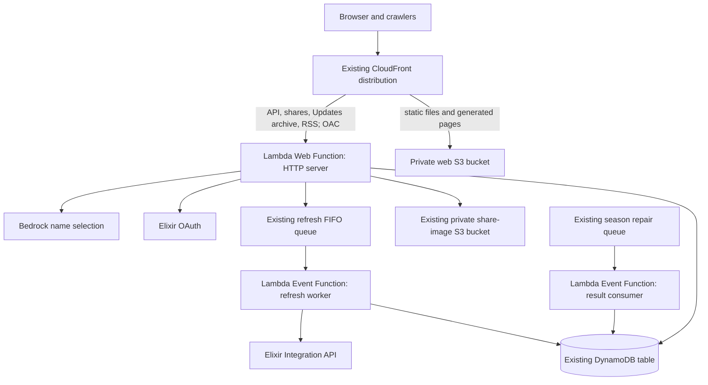

# Elixir Drop: Lambda Web Functions migration plan

Status: proposed, 2026-10-13. This is an evaluation and implementation plan;
the current architecture remains authoritative in `SPEC.md` and `AGENTS.md`.
No application or infrastructure change accompanies this document.

## Recommendation

Move Drop's HTTP backend to one Lambda Web Function in `us-east-1`, behind the
existing CloudFront distribution. Keep the Preact game, generated public pages,
card art, service worker, and version manifest on private S3. Keep queue consumers
as Lambda Event Functions. Keep DynamoDB and the retained share-image bucket.

This fits the application, but the payoff is chiefly a simpler HTTP boundary,
local server testing, and AWS-enforced origin access. Drop already runs on Lambda
and already moves slow refresh work out of player requests. Expect modest
performance impact and negligible API Gateway savings at today's traffic.
Do not justify this as a gameplay-speed improvement or a cost-saving project.

The scope is the API transport and its deployment, not a framework rewrite,
server-side rendering project, database migration, or multi-Region launch.

## Evidence and expected impact

Source reviewed: fresh `origin/main` at `7f5339e`, rather than the older local
main checkout. The implementation now signs accounts in only through Elixir;
Drop's email sign-in, SES sender, and newsletter were retired on 2026-10-12.
The migration must preserve that behavior, including `POST /auth/request` → 404.

Read-only AWS evidence, collected 2026-10-13 at approximately 4:40 p.m. Central:

- The production stack is `UPDATE_COMPLETE` and still exposes an HTTP API
  Gateway origin, one public API Lambda, a DynamoDB table, and CloudFront/S3.
- Seven daily CloudWatch buckets over October 6–13 contain **1,901 requests**,
  **zero 5xx responses**, and **32 4xx responses**. Requests include operational
  traffic; they are not a count of people or games.
- Daily mean gateway latency is approximately **525–745 ms**. The difference
  between gateway and integration means is approximately **4.8–5.3 ms**.
  That is evidence of small gateway overhead, not a cold-start measurement or
  a promise about latency percentiles. The window spans recent auth changes.

At this rate, 30 days is approximately 8,150 API requests. At the published
first-tier HTTP API price of $1/million, removing the gateway saves about
**$0.008/month**, before credits. See [API Gateway pricing](https://aws.amazon.com/api-gateway/pricing/).

| Outcome                                                                   | Assessment                                                                                     |
| ------------------------------------------------------------------------- | ---------------------------------------------------------------------------------------------- |
| Standard Node HTTP server and local HTTP tests                            | Clear improvement over API Gateway event fixtures alone                                        |
| Remove the HTTP API, integration, stage, and duplicate route declarations | Useful reduction in transport configuration                                                    |
| Restrict unsigned origin access through CloudFront OAC                    | Useful improvement; today's private marker establishes IP trust but does not close the gateway |
| Lower latency                                                             | Plausible for some bursts or initialization behavior; gateway removal alone is small           |
| Lower monthly cost                                                        | Unproven; memory occupancy and logging may offset the tiny gateway saving                      |
| Faster in-game response or rendering                                      | No direct change; gameplay runs in the browser                                                 |
| Global availability                                                       | No improvement in this plan; the data and queues remain regional                               |

AWS announced this form factor on October 12. It is available in `us-east-1`
and supports Node 24 on Arm64, matching Drop's current runtime and architecture.
Treat launch-day tooling and integration behavior as things to prove in the
isolated spike. [Launch announcement](https://aws.amazon.com/blogs/aws/announcing-aws-lambda-web-functions-for-fast-consistent-web-app-performance-anywhere/).

## Current and proposed runtime

The Web Function replaces `HttpApi`, `ApiIntegration`, the Gateway routes and
stage, `ApiInvokePermission`, and eventually `ApiFunction`. Its final runtime
role gets the existing HTTP application's DynamoDB, share S3, refresh enqueue,
and Bedrock permissions, plus its log destinations. It gets no refresh dequeue
or season-repair consumer permission; today's `ApiRole` also supports that
consumer, so do not reuse it indiscriminately. The consumer keeps its own
necessary grant when the old HTTP Lambda is removed.

The refresh worker and retained `cr-results` repair consumer remain event-based.
Web Functions serve HTTP; AWS directs queue/event processing to Event Functions.
[Web Functions overview](https://docs.aws.amazon.com/lambda/latest/dg/web-functions.html).

Use a `HomeRegion` endpoint. DynamoDB conditional writes, account identity,
run consumption, awards, and FIFO ordering remain one regional system. Putting
compute in several Regions would add cross-Region data calls or require a
separate consistency design. AWS's MultiRegion endpoint routing is latency-based
and does not provide health-based failover.
[Endpoint types](https://docs.aws.amazon.com/lambda/latest/dg/web-functions-endpoints.html).

## HTTP implementation

### Extract a small transport boundary

Keep the current explicit route table and domain modules. Start with `node:http`;
Drop does not need a new framework to migrate an already-organized router.

Introduce application-owned request/response types in `services/api`, carrying
the method, path, query parameters, normalized headers, body bytes, trusted
client context, request ID, and route template. Responses carry status, headers,
and text or bytes. `routes/context.ts`, `http.ts`, and route modules consume that
boundary rather than `APIGatewayProxyEventV2` or structured Gateway results.

During transition, keep two thin entries over the same dispatcher:

- `handler.ts`: converts Gateway events/results for the existing production path.
- `server.ts`: receives real HTTP requests and writes real HTTP responses.

Neither entry owns scoring, authentication, repository rules, or XP. A temporary
compatibility conversion is acceptable inside the Gateway entry; synthesizing a
Gateway event for every Web Function request is not the intended final design.

The server binds the exact host and port in `AWS_LAMBDA_HTTP_ENDPOINT`, with a
local fallback only when it is absent. Package an `index.js` entry and production
dependencies, using the existing esbuild approach. Bundle the SDK dependencies
used by the application; do not rely on a platform-provided SDK version.
The server must listen within ten seconds. Audit packaged dependencies for
Linux Arm64 compatibility. [Runtime requirements](https://docs.aws.amazon.com/lambda/latest/dg/web-functions-runtimes.html),
[package requirements](https://docs.aws.amazon.com/lambda/latest/dg/web-functions-configuration-deployment-package.html).

### Preserve the wire contract

Inventory from `handler.ts` and its tests, not the README's abbreviated route
list. Include profile sharing, owner season/XP reads, invitation compatibility,
Practice checkpoints, run reports, and all authentication routes.

Preserve status/error codes, optional versus required sessions, JSON content
types, HEAD semantics, redirect locations, HTML/RSS, cache headers, and exact
PNG bytes. Today PNG responses are base64-encoded Gateway results; the HTTP
server must decode/write bytes, not return base64 text. Preserve the existing
JSON image-upload contract and image validation.

Add bounded request-body collection before JSON parsing. Derive per-route
limits from accepted transcript/checkpoint bounds and the share-upload validator;
do not adopt a framework's small default body limit or an arbitrary global
limit that silently breaks valid Practice or PNG submissions. Test the largest
valid payloads and oversize rejection without allocating unlimited buffers.

Keep allowlisted CORS for localhost development and the canonical origin.
OPTIONS and error responses must receive the appropriate headers. Reject
unapproved origins; CORS is not authentication. Build URLs from configured
`APP_URL`, never an unvalidated Host or forwarded-host header.

### Preserve IP trust and bearer authorization

Configure the production endpoint with `IamAuth`. Attach CloudFront OAC using
origin type `lambda`, `sigv4`, and signing behavior **`always-amz-auth`**.
Grant `lambda:InvokeWebFunctionEndpoint` to CloudFront for the production
endpoint, restricted to the distribution ARN. Unsigned direct requests must
fail before application processing. IAM principals with an explicit invoke
grant can still call directly; audit these grants rather than claiming OAC
alone bans every direct signed caller.
[Endpoint access control](https://docs.aws.amazon.com/lambda/latest/dg/web-functions-endpoint-access-control.html).

**Authorization must be included in the cache policy for every behavior using
the Web Function origin.** The current managed CachingDisabled policy and
AllViewerExceptHostHeader origin policy are not sufficient proof. Create an
explicit zero-TTL policy including Authorization for API/share behaviors;
provide an appropriate Authorization-aware policy for the cached public
archive/feed behaviors. Keep public archive/feed caching bounded by their
existing response headers. Never cache owner/session responses.
`always-amz-auth` preserves the viewer bearer header while signing separately;
`always` and `no-override` are wrong for this origin.
[CloudFront Web Function OAC](https://docs.aws.amazon.com/ja_jp/AmazonCloudFront/latest/DeveloperGuide/private-content-restricting-access-to-lambda-web.html).

Keep the edge function's overwrite of `x-elixir-drop-viewer-ip` from
`event.viewer.ip`. The application may trust that value only on the
distribution-authenticated production entry; controlled direct probes have no
trusted viewer context and must not be permitted to impersonate it.
Do not trust the first `X-Forwarded-For` value or use the TCP peer as the viewer:
AWS says earlier forwarded values are unvalidated and the last value behind
CloudFront identifies its edge. Platform request IDs come from
`lambda-web-request-id`. [HTTP context](https://docs.aws.amazon.com/lambda/latest/dg/web-functions-http.html).

Retain the private origin marker through coexistence. Remove it only after the
OAC path and IP trust tests pass and the old direct Gateway path retires.
Use the same `TELEMETRY_PEPPER` and signing secret on both entries: transport
changes must not sever correlation history, sessions, or in-flight challenges.

### Audit concurrent requests

`timings.ts` already uses AsyncLocalStorage, a good starting point. Preserve it
and test deliberately interleaved requests. The cached config, immutable card
maps, and SDK clients may be shared; player/session context, request bodies,
rate-limit decisions, and request caches may not.

Prove simultaneous retries cannot double-record a completion, credit XP twice,
consume OAuth/sign-in state twice, or bypass a Practice checkpoint cursor.
Use existing DynamoDB transactions and conditional writes rather than adding
process locks. Referee decisions remain strongly consistent and uncached
between requests. Audit every mutable module-level value and every mutation
across an await boundary.

Keep important work awaited or durably queued. A live HTTP process after a
response is not a durable worker. Best-effort draining and a one-second SIGTERM
cleanup window cannot guarantee completion. Keep finalization-before-clock-cache
ordering and FIFO retries in the worker.
[Environment lifecycle](https://docs.aws.amazon.com/lambda/latest/dg/web-functions-env-lifecycle.html).

## Capacity and economics

Initial proposed values, to validate under isolated load:

| Setting                             | Proposal        | Reason                                                                            |
| ----------------------------------- | --------------- | --------------------------------------------------------------------------------- |
| Runtime / architecture              | Node 24 / Arm64 | Matches current application                                                       |
| Home Region                         | `us-east-1`     | Co-locate table, S3, queues and Bedrock calls                                     |
| Request timeout                     | 20 seconds      | Preserve today's application ceiling                                              |
| Maximum concurrency per environment | 8               | Conservative start while testing scoring and concurrent uploads                   |
| Maximum production environments     | 3               | Nominal ceiling of 24 in-flight requests, near today's reserved concurrency of 25 |
| Endpoint request rate               | 100 RPS         | Lowest nonzero platform setting; validate the increase from today's 50 RPS guard  |
| Automatic deployment                | Disabled        | Explicit tested revision promotion                                                |

These are proposals, not measured optimal values. The product of environments
and concurrency is an upper bound; adaptive concurrency can be lower, and
temporary environment overshoot can occur. Endpoint rate control is not the
same as Gateway's existing 100-request burst setting. Exercise bursts and
client backoff rather than claiming an identical throttle. Extra endpoints also
have independent capacity; cap the candidate endpoint separately and retire it
after promotion. [Scaling controls](https://docs.aws.amazon.com/lambda/latest/dg/web-functions-scaling.html).

AWS requires nonzero rate limits up to 1,000 RPS to be multiples of 100: today's
50 RPS cannot be copied. Preserve application per-IP/per-route rate limits and
test the proposed 100 RPS platform guard with the conservative environment cap.
If exactly 50 RPS globally is necessary, account for an additional shared limiter
in the spike's complexity assessment rather than quietly widening exposure.

Web Functions have a different billing model: requests, active CPU, consumed
memory over environment lifetime, and transfer. I/O wait avoids CPU billing,
but memory continues to accrue between requests. There is no Event Function
512 MB allocation knob to copy.

Published US East/Arm rates used for evaluation:

| Dimension  | Rate                          |
| ---------- | ----------------------------- |
| Requests   | $0.30 per million             |
| Active CPU | $0.0000276944 per vCPU-second |
| Memory     | $0.0000036667 per GB-second   |

Model cost as `requests × request rate + measured CPU-seconds × CPU rate +
measured memory GB-seconds × memory rate`, plus transfer and logs. Do not model
memory as request duration alone. Illustratively, a continuously resident
0.2 GB environment costs about $1.90/month for memory alone; actual residency
can be much lower with scale-to-zero. This is sensitivity analysis, not Drop's
forecast. Compare measured Web usage with current Lambda duration/requests and
Gateway billing, applying account credits separately.
[Lambda pricing](https://aws.amazon.com/lambda/pricing/).

Retain scale-to-zero. Do not add heartbeat traffic to keep the server warm.
At this request volume, cold starts remain possible and shared concurrency may
be infrequently useful. Record initialization, CPU, memory, and request latency
in the isolated benchmark and natural production observation.

## Infrastructure and deployment changes

Stay in Drop's existing CloudFormation stack and path-aware OIDC pipeline.
Introduce `AWS::Lambda::WebFunction`, `AWS::Lambda::WebFunctionRevision`, and
`AWS::Lambda::WebFunctionEndpoint`; keep separate logical resources for the
current and candidate revisions. Build an HTTP ZIP separately from event-worker
code. Use content-addressed keys in the existing versioned code bucket, with
Lambda service read permission scoped to this Web Function's revision ARNs.

Read the native schemas before implementing. Code, environment variables,
runtime, timeout, and concurrency live on immutable revisions; endpoint weights
select a revision. Never reference a bare ARN where a resource expects the
function name. References:
[function](https://docs.aws.amazon.com/AWSCloudFormation/latest/TemplateReference/aws-resource-lambda-webfunction.md),
[revision](https://docs.aws.amazon.com/AWSCloudFormation/latest/TemplateReference/aws-resource-lambda-webfunctionrevision.md),
[endpoint](https://docs.aws.amazon.com/AWSCloudFormation/latest/TemplateReference/aws-resource-lambda-webfunctionendpoint.md).

**Known tooling question:** the regional `DescribeType` schema for
`AWS::Lambda::ResourcePolicy` still constrains `ResourceArn` to an Event Function
ARN/name pattern. It does not admit `web-function/...`; the documentation also
has inconsistent property naming. Do not assume that resource can attach this
policy. Recheck in the spike. If native support remains absent, implement one
small stack-owned custom resource calling the Web policy API, including
update/delete behavior and conflict handling. Its role is restricted to this
function; it owns the complete policy and emits no application secrets. Do not
leave a manual policy step or silently use a public endpoint.
[Resource policy reference](https://docs.aws.amazon.com/AWSCloudFormation/latest/TemplateReference/aws-resource-lambda-resourcepolicy.html),
[Web PutResourcePolicy](https://docs.aws.amazon.com/lambda/latest/lambda-web/API_PutResourcePolicy.html).

Deployment mechanics:

1. Build/package a candidate from the exact validated main SHA. Preserve worker
   artifacts and previously deployed revision resources.
2. Create a candidate revision/endpoint without moving production routing.
   A controlled IAM-signed probe checks startup and read-only health. Full
   bearer/OAC behavior is tested through the isolated CloudFront stack.
3. Promote through CloudFormation, then smoke the canonical CloudFront paths.
   Verify revision routing and actual HTTP responses, not only Active state.
4. Save the last known good revision and previous CloudFront origin selection.
   Keep rollback revisions and artifacts referenced through the observation
   window; remove them deliberately afterward. Demonstrate replacement and
   rollback in the spike, including CloudFormation's attempted deletion of old
   immutable revisions.

Preserve CI cancellation, exact-head gating, serialized production writes, and
`WEB_VERSION`: API-only deploys preserve the web version; web/shared deploys
update it before publishing the corresponding static artifact. Revision identity
must include configuration changes as well as code. Identical code/config must
remain a no-op. Promotion cannot leave unmanaged endpoint-weight drift.

Expose canonical `https://drop.poapkings.com/api` as the application `ApiUrl`;
keep the origin domain/revision in separate diagnostic outputs. Published
`api-config.json` remains `/api`. Update dev configuration, `DROP_API_URL`
overrides, the player-Updates CLI/Control Room, season briefs, and smoke scripts
to stop depending on direct `execute-api` access. Local development should use
the local server or the canonical CloudFront URL with allowlisted CORS, never
an unsigned private origin.

Reuse existing CloudFormation secret parameters with `UsePreviousValue`.
Preserve OAuth client settings, signing secret, pepper, integration key, and
Updates publication token; values never enter code artifacts, logs, the browser,
PRs, or a new CI secret copy. The new runtime receives them through the existing
stack parameter path. Update deployment grants for the `web-function/` ARN
namespace, exact Web APIs, log destinations, code-bucket read policy, and
pass-role target. Existing `function:elixir-drop-*` grants do not cover Web
resources. Apply those changes through reviewed infrastructure deployment.

## Monitoring and acceptance

Replace Gateway Count/5xx/Latency and Event Lambda concurrency/throttle panels
for the HTTP surface with Web Function metrics. Retain the worker, queue, table,
CloudFront, and repair-consumer alarms.

- `AWS/Lambda/Web`: `ExecutedRequests`, `HTTPResponseStatusClass5XX`,
  `EnvironmentCPUTime`, `EnvironmentActiveTime`, `EnvironmentMaxMemoryUsage`.
- `AWS/Lambda/Web/Usage`: endpoint rate/environment throttles and active
  environments, with the documented regional dimensions.
- Structured request logs: route template, status, request ID, build/revision,
  elapsed time, and existing bounded operation labels. Keep identities, IPs,
  OAuth query values, bearer tokens, and raw paths out of application logs.

Web metrics lack a revision dimension; record build identity in application
logs. Error metrics are sparse: configure missing-data behavior, and avoid
reading no traffic as acceptance. Obtain per-route latency from application
timings; do not invent a Gateway-equivalent native latency metric.
[Web metrics](https://docs.aws.amazon.com/lambda/latest/dg/web-functions-monitoring-metrics.html).

Precreate a dedicated HTTP log group and its `.local` companion with the
existing retention policy and narrow runtime write grants. The old API log
group stays available for comparison. Check Web log schemas before porting
queries: initialization and periodic environment reports replace assumptions
about a REPORT line for each Lambda invocation.
[Logging](https://docs.aws.amazon.com/lambda/latest/dg/web-functions-logging.html).

Required validation before production cutover:

| Layer                 | Required evidence                                                                                                                                          |
| --------------------- | ---------------------------------------------------------------------------------------------------------------------------------------------------------- |
| Existing domain tests | Scoring, signatures, accounts, XP, badges, referee visibility, checkpoints, deletion, clock finalization stay green                                        |
| HTTP parity           | Full route inventory, errors, CORS, redirects, query decoding, HEAD, content types, cache headers, PNG bytes and maximum payloads                          |
| Isolation/concurrency | Interleaved players cannot share context; parallel duplicate writes remain exact-once; timings stay request-local                                          |
| Package               | Start the exact production ZIP under Node 24 with the advertised bind address; no dependencies from the checkout                                           |
| Isolated cloud        | Real Web Function + CloudFront OAC + separate disposable DynamoDB/S3/SQS and independent secrets; no production player writes or Elixir acceptance traffic |
| Origin/auth trust     | Unsigned direct origin denied; fake viewer IP overwritten; legitimate bearer survives OAC; owner data never cached                                         |
| Load/resilience       | Bounded mixed reads/scoring/uploads; cold startup, limits, retry behavior, termination, interrupted response, replacement and rollback                     |
| Browser               | Existing deployment smoke against isolated API; authenticated, guest, Practice/offline, sharing, installed/stale-client behavior                           |

Run `npm run verify:non-browser` for backend/infra changes and the repository's
browser/deployment gates when the HTTP integration or fixtures change. AWS also
recommends package and isolated-cloud tests for Web Functions.
[Testing layers](https://docs.aws.amazon.com/lambda/latest/dg/web-functions-testing.html).

**Change the production smoke before cutover.** `infra/scripts/smoke.mjs`
currently calls `/runs/start` as a guest; that writes a run/TTL row and consumes a
rate-limit counter. Move successful guest start/completion checks into the
isolated suite. A route named GET is not proof of being write-free either:
`/stats` may enqueue a clock refresh and profile reads may reconcile projections.
Production acceptance uses bounded canonical health/content reads, deliberate
refusal paths, existing logs, and natural activity; acknowledge any existing
enqueue-on-read behavior. Never replay real completion requests into both
backends or manufacture players, games, shares, Updates, or mail for acceptance.

Cutover acceptance requires working canonical health and auth routing, correct
existing archive/feed/share responses, no owner cache leakage, no new
transport-caused 5xx/timeouts/throttles, and natural sign-in/run/worker evidence
as it becomes available. In isolated comparisons, flag route p95 regressions
above 20% or 100 ms (whichever is larger); measure cold/warm separately and use
enough samples per route. Do not apply these numbers as statistical proof to a
handful of natural requests. Any auth isolation, scoring, duplicate-award, or
IP-correlation regression blocks promotion regardless of latency.

## Delivery sequence and rollback

| Step                             | Deliverable and exit condition                                                                                                                                                                                                                            |
| -------------------------------- | --------------------------------------------------------------------------------------------------------------------------------------------------------------------------------------------------------------------------------------------------------- |
| 1. Isolated spike                | Prove ZIP startup, OAC Authorization/cache requirements, policy attachment, CloudFormation replacement/rollback, metric/log schemas and bounded capacity. Stop if this requires an outsized deployment workaround.                                        |
| 2. Shared HTTP boundary          | Add request/response types, dispatcher and local server, retaining Gateway production entry. Full wire/concurrency parity tests pass. Coordinate with open local-dev-harness PR #56 rather than duplicating it.                                           |
| 3. Parallel production resources | Add Web Function, candidate/prod endpoints, narrowly scoped role, policy and monitoring alongside the old origin. Production stays on Gateway; canonical clients/tooling and read-only smoke are ready.                                                   |
| 4. Cutover                       | Switch **all five dynamic CloudFront behaviors** to the Web origin together. Preserve viewer rewrite, callbacks, signing values and storage. Verify canonical requests and observe natural traffic.                                                       |
| 5. Retire old transport          | After at least seven days with representative natural auth/run/Practice/share evidence and no unresolved regression, remove Gateway, old HTTP Lambda/permission/log delivery and marker configuration. Retain historical logs; simplify entrypoints/docs. |

Initial origin cutover is a deliberate blue-green switch, not revision canarying:
Web revision weights cannot split traffic with the old Gateway origin. Keep both
origins and a CloudFormation origin-selector parameter during the first week.
If a necessary natural journey has not happened, extend observation rather than
declaring it tested. Subsequent Web-only releases can use revision weights;
at current traffic, isolated tests and explicit promotion are more informative
than a tiny percentage canary.

Rollback during coexistence sets the five dynamic behaviors back to Gateway,
waits for distribution propagation, and checks canonical health/content.
Preserved secrets, data shapes, and the shared dispatcher allow sessions and
run tokens to cross the switch. Requests already in flight may complete;
client retries must stay idempotent. After retirement, rollback routes the Web
endpoint to a retained known good revision. Do not delete serving revisions
or change data/signing formats as part of this migration.

Rough effort: **3–5 engineering days**, including isolated infrastructure proof,
transport extraction, meaningful tests, deploy integration and cutover; then
at least one week of natural observation before cleanup. This is a planning
estimate, not measured throughput. The policy-provider gap and existing local
dev harness are the largest variables. Four or five focused implementation PRs
are sufficient; the observation period does not require daily code changes.

Implementation updates `SPEC.md`, the golden-rule API-origin sentence in
`AGENTS.md`, workspace/infra READMEs, operations queries and deployment tooling
only as each phase lands. Do not publish a player Update for this transport
maintenance. No sibling project changes or canonical CR reference edits are
required unless implementation uncovers a separate owner-specific defect.

The recommended decision is to proceed with the bounded isolated spike and
HTTP migration, preserving the static delivery and event-worker architecture.
The spike must establish that the new deployment remains understandable; a
complicated policy workaround would outweigh this project's small benefit.
